<!-- ✦ Hania Kulsum · profile.sh --live ✦ -->
<picture>
  <source media="(prefers-color-scheme: dark)" srcset="dark.svg">
  
</picture>

 

<picture>
  <source media="(prefers-color-scheme: dark)" srcset="https://streak-stats.demolab.com?user=haniakulsum&background=0A101F&border=1E2A44&stroke=22D3EE&ring=A78BFA&fire=F472B6&currStreakNum=E2E8F0&sideNums=E2E8F0&currStreakLabel=A78BFA&sideLabels=22D3EE&dates=5B6B8C&border_radius=10">
  
</picture>

<picture>
  <source media="(prefers-color-scheme: dark)" srcset="https://github-readme-stats-sepia-six.vercel.app/api?username=haniakulsum&show_icons=true&hide_rank=true&count_private=true&bg_color=0A101F&title_color=A78BFA&text_color=E2E8F0&icon_color=22D3EE&border_color=1E2A44&border_radius=10">
  
</picture>
<picture>
  <source media="(prefers-color-scheme: dark)" srcset="https://github-readme-stats-sepia-six.vercel.app/api/top-langs?username=haniakulsum&layout=compact&langs_count=8&size_weight=0.5&count_weight=0.5&bg_color=0A101F&title_color=A78BFA&text_color=E2E8F0&border_color=1E2A44&border_radius=10">
  
</picture>

  

<picture>
  <source media="(prefers-color-scheme: dark)" srcset="https://raw.githubusercontent.com/haniakulsum/haniakulsum/output/github-snake-dark.svg">
  
</picture>

  

  &nbsp;&nbsp;
  &nbsp;&nbsp;
  

